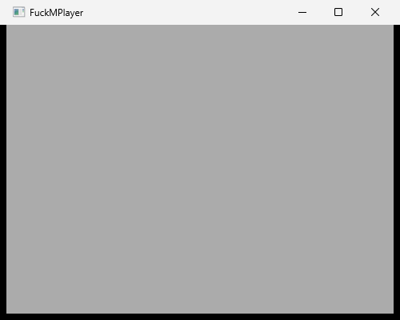

# fuck-music-player

[](LICENSE)
[](https://github.com/esrrhs/fuck-music-player/actions)
[](https://github.com/esrrhs/fuck-music-player/releases)
[](https://github.com/esrrhs/fuck-music-player/stargazers)

[English](README.md) | [中文说明](README_CN.md)

Plugin-based Windows MP3 player built with OpenGL, wxWidgets, CEGUI, FMOD, Boost, ZeroMQ, Lua, and Protocol Buffers.

This repository is a historical Visual Studio (Win32) project from around 2011. Third-party dependency *trees are not committed*; run `scripts/fetch-deps.sh` (also used by CI) to download them. Treat it as an archive / study sample rather than a modern cross-platform app.

### CI status

GitHub Actions (`ci.yml`) on `master`:

1. **Structure and pack** (Ubuntu) — validate layout and run `./pack.sh` (fetch deps + package the `fuck/` runtime snapshot).
2. **MSBuild Release Win32** (Windows) — fetch deps (including freeglut + historical `glaux` via `msvc-overlays/opengl/`), MSBuild `FuckMPlayer.sln` **Release|Win32** including `plugin\logo`, stage a runnable `fuck/` tree, then best-effort launch `FuckMPlayer.exe` and capture a PNG of the player window. Skips proprietary FMOD plugin `musicengine` (runtime treats a missing engine as non-fatal). Uploads `win32-release-binaries` and `player-shell-screenshot`.

Screenshot capture on `windows-latest` can be flaky (black frame / no GUI session); the screenshot step is soft-fail so the MSBuild job stays green when the build itself succeeds.

Example green run (logo build + shell screenshot): [#39915123064](https://github.com/esrrhs/fuck-music-player/actions/runs/39915123064).

Player shell (CI capture, no audio/FMOD):



## Features

- Host shell (`FuckMPlayer.exe`) loads plugins as DLLs
- Plugin modules for frame/process/thread orchestration, logo splash, music engine (FMOD), and file finder
- OpenGL + CEGUI UI, wxWidgets windowing, ZeroMQ messaging, Lua scripting hooks
- Config-driven module graph via `fuck/*.cfg`

## Requirements

- Windows (Win32)
- Visual Studio with C++ desktop workload (original projects use VS 2010-era `ToolsVersion="4.0"`)
- Open `FuckMPlayer.sln` and build **Release | Win32** (or Debug)

Fetch dependencies before opening the solution:

```bash
./scripts/fetch-deps.sh
```

Downloads (pinned): wxWidgets **2.9.1**, protobuf **2.4.1**, Boost **1.46.1**, ZeroMQ **2.1.7**, CEGUI **0.7.5**, freeglut **3.0.0** (into `opengl/`), and `protoc.exe` 2.4.1. **FMOD Ex** is proprietary — set `FMOD_SDK` to an unpacked SDK or place files under `fmod/` manually.

## Build

```bat
:: Open the solution in Visual Studio, then build Release|Win32
FuckMPlayer.sln
```

After a successful build, copy plugin DLLs and the exe into the runtime folder:

```bat
fuck_release.bat
```

Debug equivalent:

```bat
fuck_debug.bat
```

Runtime directory: `fuck/` (`*.cfg`, UI assets). After building, copy plugin DLLs / the exe (`fuck_release.bat`) and third-party runtime DLLs into `fuck/`, then launch `FuckMPlayer.exe` from that folder.

## Layout

| Path | Role |
|------|------|
| `FuckMPlayer.sln` / `FuckMPlayer.vcxproj` | Host application |
| `main/` | Main plugin (render / music / UI glue) |
| `plugin/` | Plugin SDK + modules (thread, process, logo, musicengine, filefinder, …) |
| `frame/` | wxWidgets main frame |
| `common/` | Shared headers / logger |
| `ex/` | Project-owned Asio logger helpers (formerly under `boost/ex/`) |
| `fuck/` | Runtime configs + UI (DLLs fetched/built locally) |
| `msvc-overlays/` | VS2010-era `.vcxproj` overlays copied onto fetched trees by `fetch-deps.sh` |
| `scripts/fetch-deps.sh` | Download third-party trees into expected paths |
| `VERSION` | Release version source of truth |

## Release

GitHub Actions watches **`VERSION`** on `master`. When the version string changes and the tag does not yet exist, `release.yml` runs `./pack.sh` and publishes a GitHub Release with the Windows runtime snapshot zip.

Manual packaging:

```bash
./pack.sh
# -> pack/fuck-music-player-<version>-windows-x86.zip and pack.zip
```

## License

MIT. See [LICENSE](LICENSE).

Third-party libraries fetched by `scripts/fetch-deps.sh` (wxWidgets, CEGUI, ZeroMQ, protobuf, Boost, freeglut, FMOD, etc.) keep their own licenses; FMOD in particular is proprietary and not covered by the MIT grant above.
